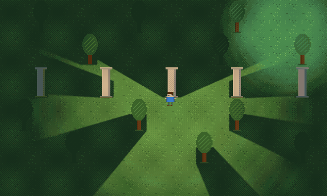
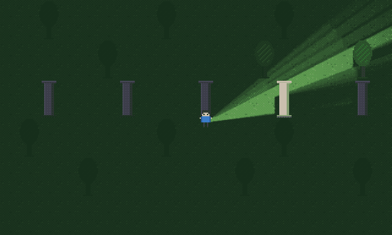
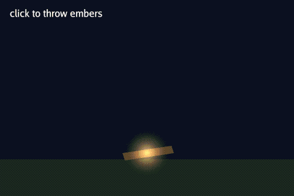
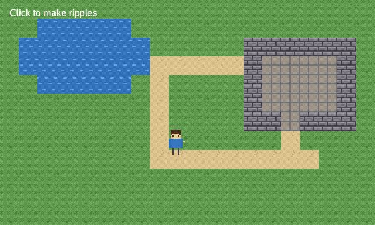
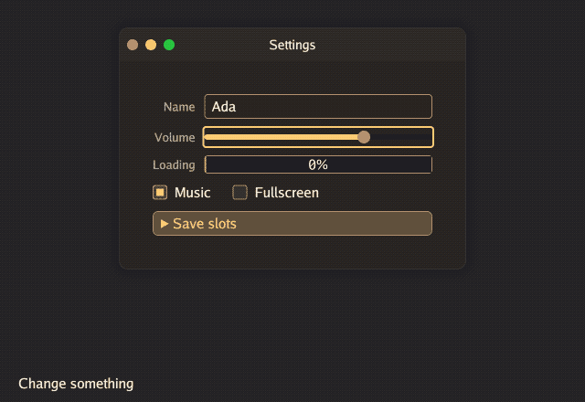
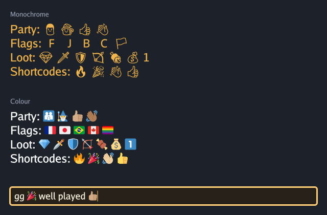
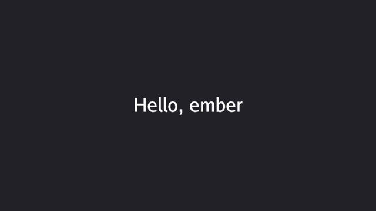

<div align="center">

# ember

**A 2D game engine in plain Go. WebGPU on the desktop and in the browser.**

[](https://github.com/merlindorin/ember/actions/workflows/ci.yml)
[](go.mod)
[](LICENSE)
[](https://ember.vanyda.cloud/ember/)


<sub>**Lantervale**, our game in development, made with ember.</sub>

</div>

## Highlights

- 🧱 **Plain Go ECS**: entities are structs, systems are small objects. No codegen, no editor.
- 🔥 **WebGPU renderer**: Metal, Vulkan, Direct3D 12, and the browser with the same code.
- 💡 **2D lights**: point, cone, directional and shape lights, soft shadows.
- ✨ **Effects**: particles, WGSL shaders, blend modes, render textures.
- 🗺️ **Worlds**: sprites, animations, tile maps, Tiled levels, collision, pathfinding.
- 🖼️ **UI in HTML + CSS**: flex, grid, the cascade, checked pixel for pixel against Chrome.
- 🔤 **Text**: font files, bitmap fonts, colour emoji, `:shortcodes:`.
- 🎮 **Input and sound**: keyboard, mouse, gamepads, touch, gestures; music, positional sound, reverb.
- 🧪 **Headless tests**: no GPU, no real time, every UI element reachable by path.

## Samples from the guide

Each one is an example of [the guide](https://ember.vanyda.cloud/ember/): click it for its page, its code and a live version in the browser.

<table>
<tr>
<td width="50%"><a href="https://ember.vanyda.cloud/ember/docs/2d/lights/point-lights/"></a></td>
<td width="50%"><a href="https://ember.vanyda.cloud/ember/docs/2d/lights/cone-lights/"></a></td>
</tr>
<tr>
<td align="center"><a href="https://ember.vanyda.cloud/ember/docs/2d/lights/point-lights/">Point lights</a></td>
<td align="center"><a href="https://ember.vanyda.cloud/ember/docs/2d/lights/cone-lights/">Cone lights</a></td>
</tr>
<tr>
<td width="50%"><a href="https://ember.vanyda.cloud/ember/docs/2d/particles/"></a></td>
<td width="50%"><a href="https://ember.vanyda.cloud/ember/docs/2d/2d-shader/"></a></td>
</tr>
<tr>
<td align="center"><a href="https://ember.vanyda.cloud/ember/docs/2d/particles/">Particles</a></td>
<td align="center"><a href="https://ember.vanyda.cloud/ember/docs/2d/2d-shader/">A 2D shader</a></td>
</tr>
<tr>
<td width="50%"><a href="https://ember.vanyda.cloud/ember/docs/ui/walkthroughs/controls/"></a></td>
<td width="50%"><a href="https://ember.vanyda.cloud/ember/docs/text/emoji/"></a></td>
</tr>
<tr>
<td align="center"><a href="https://ember.vanyda.cloud/ember/docs/ui/walkthroughs/controls/">UI controls</a></td>
<td align="center"><a href="https://ember.vanyda.cloud/ember/docs/text/emoji/">Emoji</a></td>
</tr>
<tr>
<td colspan="2" align="center"><b><a href="https://ember.vanyda.cloud/ember/docs/">More in the guide →</a></b></td>
</tr>
</table>

## Made with ember

<table>
<tr>
<td width="50%"></td>
<td width="50%"></td>
</tr>
<tr>
<td align="center"><sub>Lantervale: a room lit by its torches</sub></td>
<td align="center"><sub>Lantervale: a power-up screen</sub></td>
</tr>
</table>

## Quick start

Needs Go 1.27, [Task](https://taskfile.dev) (`brew install go-task`) and a [WebGPU-capable GPU](docs/01-getting-started/README.md).

```sh
git clone https://github.com/merlindorin/ember
cd ember
task wgpu                        # the WebGPU library
go run ./examples/01-hello-cube
```

## Hello

```go
package main

import (
	"github.com/merlindorin/ember"
	"github.com/merlindorin/ember/platform"
	"github.com/merlindorin/ember/twod"
)

func main() {
	ember.New().
		AddEntities(platform.NewWindow(platform.Title("hello"), platform.Size(640, 360)).
			Add(twod.NewText("Hello, ember", twod.At(320, 180), twod.FontSize(32)))).
		MustRun()
}
```



## Learn

- 📖 [The guide](https://ember.vanyda.cloud/ember/): one idea per page, its examples runnable in the page (`task docs` serves it locally)
- 🧩 [Tons of examples](examples), written by AI and carefully reviewed by humans: `go run ./examples/NN-name`
- 🧭 [Design decisions](docs/99-decisions/README.md): each choice and the alternatives it beat

> ember is young: its API still moves, and the guide shows only what is ready.

## Licence

Code under [MIT](LICENSE). Pictures, fonts and sounds: see [CREDITS.md](CREDITS.md).
