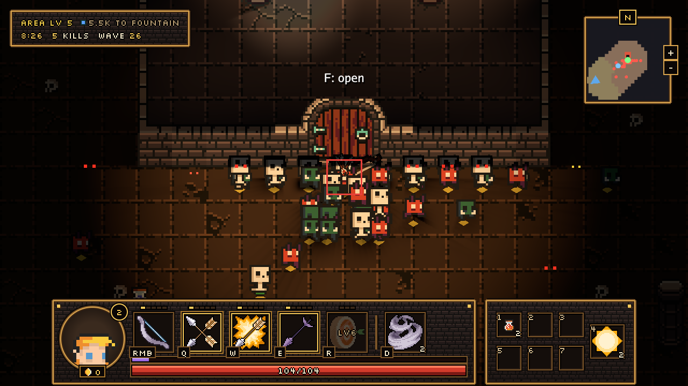
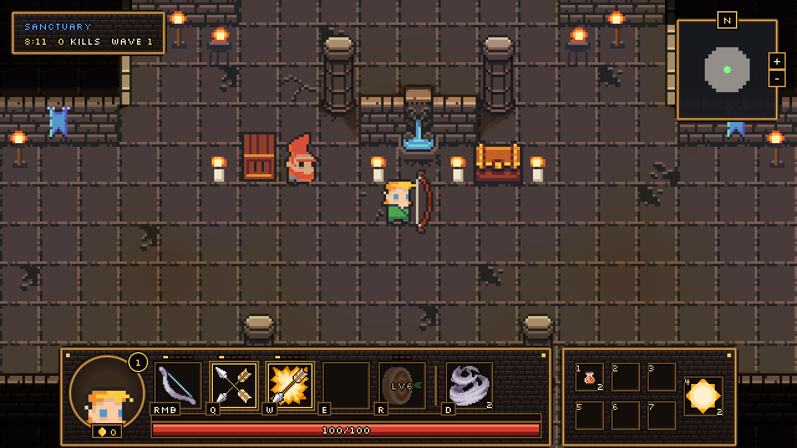
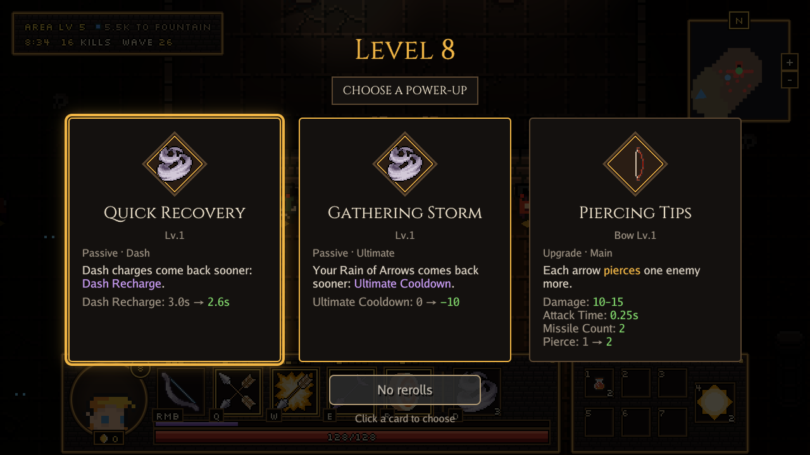

<div align="center">

# ember

**A Go game engine for online games: plain structs, small systems, WebGPU on the desktop and in the browser.**

[](https://github.com/merlindorin/ember/actions/workflows/ci.yml)
[](go.mod)
[](LICENSE)
[](https://ember.vanyda.cloud/ember/)



<sub>Lantervale, our game in development, built on ember: 2D lights and shadows, a horde on a flow field, a HUD made of ui elements.</sub>

</div>

## Why ember

- **Just Go.** Entities are structs, components are fields, systems are small objects with an `Update`. No code generation, no editor, no scripting language: `go run` and you're in.
- **Online first.** The same simulation runs on a headless server and a windowed client. The pure packages (`world`, `twod`, `ui`, `collide`, `nav`, `audio`…) never touch cgo, so a server builds anywhere.
- **WebGPU everywhere.** One renderer on Metal, Vulkan and Direct3D 12, and in the browser through `GOOS=js`: the guide's examples run right in the page.
- **A real 2D toolkit.** Sprites and animations, tile maps and Tiled levels, point, cone, directional and shape lights with soft shadows, particles, render textures, WGSL effects, pixel-perfect scaling, text with fallback faces and colour emoji.
- **UI you already know.** HTML elements built from Go and styled by a CSS subset (flex, grid, the cascade), checked pixel for pixel against headless Chrome. Callbacks on the element, focus, gamepad navigation, text editing with undo.
- **Testable to the bone.** Tests need no GPU and no real time: drive input over `RunFrames`, record sound into a buffer, find any ui element by path. A Connect automation server lets scripts and agents play a running game.

## Quick start

You need Go 1.27, [Task](https://taskfile.dev) (`brew install go-task`) and a GPU that WebGPU supports ([Getting started](docs/01-getting-started/README.md) lists them).

```sh
git clone https://github.com/merlindorin/ember
cd ember
task wgpu                        # fetches the WebGPU library the renderer loads
go run ./examples/01-hello-cube
```

## A window

```go
package main

import (
	"github.com/merlindorin/ember"
	"github.com/merlindorin/ember/platform"
	"github.com/merlindorin/ember/twod"
)

func main() {
	win := platform.NewWindow(platform.Title("hello"), platform.Size(640, 360))
	win.Add(twod.NewText("Hello, ember", twod.At(320, 180), twod.FontSize(32)))
	ember.New().AddEntities(win).MustRun()
}
```

## Entities and systems

An entity is a struct embedding `*world.BasicEntity` and its components. A system embeds a `world.Group` of an interface, and the World hands it every entity that matches. No window needed: this one runs anywhere, a server included.

```go
package main

import (
	"fmt"

	"github.com/merlindorin/ember/world"
)

type Heat struct{ Degrees float32 }

func (h *Heat) GetHeat() *Heat { return h }

type Flame struct {
	*world.BasicEntity
	Heat
	Name string
}

type Burning interface {
	world.BasicFace
	GetHeat() *Heat
}

type Cooling struct{ world.Group[Burning] }

func (s *Cooling) Update(f world.Frame) {
	for flame := range s.All() {
		flame.GetHeat().Degrees -= f.DT
		if flame.GetHeat().Degrees <= 0 {
			fmt.Printf("%.1fs  %s went out\n", f.Elapsed, flame.(*Flame).Name)
			f.World.RemoveEntity(flame)
		}
	}
}

func main() {
	world.New().
		AddEntities(
			&Flame{BasicEntity: world.NewBasic(), Heat: Heat{2}, Name: "candle"},
			&Flame{BasicEntity: world.NewBasic(), Heat: Heat{5}, Name: "campfire"},
		).
		AddSystems(&Cooling{}).
		On(world.Update, "quit", func(f world.Frame) {
			if f.World.Len() == 0 {
				f.Quit()
			}
		}).
		MustRun()
}
```

## What it looks like

<table>
<tr>
<td width="50%"></td>
<td width="50%"></td>
</tr>
<tr>
<td><sub>Point lights from every torch and candle, shadows from the pillars.</sub></td>
<td><sub>A power-up screen: ui elements, a stylesheet and pixel fonts over the paused world.</sub></td>
</tr>
</table>

## Learn it

[The guide](https://ember.vanyda.cloud/ember/) is the way in: each page is one idea, a few lines of code and an example you can run in the page or with `go run`. It goes from the World and its systems to windows, UI, 2D, text, input and sound, and `task docs` serves it locally. The engine's design choices, with the alternatives they beat, are in [docs/99-decisions](docs/99-decisions/README.md).

ember is young and its API still moves; the guide only shows what is ready.

## Licence

ember's code is under the [MIT licence](LICENSE). Its pictures, fonts and sounds come with their own licences, listed in [CREDITS.md](CREDITS.md) and in the CREDITS files beside them.
