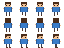

# Sprite sheets

A sprite sheet holds every frame of a character in one picture. Here a little hero walks with the arrow keys, playing the clip that faces where it goes, and stops on its first frame when no key is held.

The sheet: four frames a row, walking down, up and to the side.

## Clips

`twod.Strip` cuts the sheet into frames of a `Cell` of 16 × 16 pixels, and `twod.NewAnimations` names clips made of them: `down`, `up` and `side`, at 8 frames a second, each with `Loop()`; `PingPong()` and `Once()` are the other ways a clip can repeat. `twod.Animate` gives them to the sprite.

[main.go](../../examples/20-sprite-sheet/main.go)

## Walking

`Walk` reads the window's arrow keys as two axes. It moves the hero with `Translate`, plays the clip for its direction with `Play`, and mirrors the side clip with `SetFlip` to walk left, since the sheet only faces right. With no key held, `Stop` goes back to the clip's first frame. `Picture()` is what the sprite shows now, its texture and the region in pixels: the clip's current frame, or its still picture. With `Flip()` and `Rotation()`, it redraws the sprite's current look elsewhere, such as a silhouette or an outline drawn on a canvas.

[walk.go](../../examples/20-sprite-sheet/walk.go)

## The ground

The hero walks on grass: a tile map of the first tile of the meadow from [Tile maps](08-tile-maps.md), added to the window before the hero so it draws behind him.

[ground.go](../../examples/20-sprite-sheet/ground.go)

## Try it

[20-sprite-sheet](../../examples/20-sprite-sheet)
