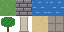

# Tile maps

A tile map builds a level from small square tiles, laid out on a grid. Here a meadow with a pond, a sand path and a walled yard is drawn from one sheet of 16 × 16 tiles, written as a picture in text; the pond's water ripples.

The tiles, numbered from 1, left to right then top to bottom:




## The level

The level is a picture in text, one character a cell, and a legend that says which tile each character stands for. Naming the tiles with constants keeps the numbers readable.

[level.go](../../examples/26-tilemap/level.go)

## The map

`twod.NewTileset` cuts the sheet into 16 × 16 tiles, and `TileAnimation` makes the water alternate with its ripple twice a second. `twod.NewTileMap` lays the tiles out with `ASCII(level, legend)`, and `CellSize` draws each cell 32 points wide, so the pixel art is doubled. A map's position is the top-left corner of its first cell, so `Pivot` doesn't apply to it. It draws only the cells in view: a map a thousand cells wide costs no more than one screen. Isometric maps are the exception: they draw every cell and have no collision.

[main.go](../../examples/26-tilemap/main.go)

Every tile draws whole, never resized or cut, at its tileset's one scale: the scale at which the tileset's grid tile fits the map's cell width, here 2. Its bottom-left sits on its cell's, so a tile bigger than the grid rises above its cell or spreads to its right, and the map draws the cells whose tiles reach into view, not only those in it ([decision 0034](../99-decisions/0034-every-tile-draws-whole.md)).

A tileset can also hold tiles of their own sizes. `twod.LoadTiledTileset(files, "walls.tsj")` reads a tileset saved by [Tiled](11-tiled.md): a grid, or a collection with a picture per tile or a rectangle of a shared one. `twod.MergeTilesets(floor, walls)` puts several together, numbering each set's tiles on from the last one's, so one map can draw from all of them. A tile's custom properties are `tileset.Properties(id)`, `tileset.ID("pillar")` finds a tile by its `name` property, `TileSize(id)` is its size in pixels, and `Picture(id)` its texture and rectangle in it, the first frame of an animated tile, to draw a tile's own image elsewhere, as a sprite's `Picture` does; a map's `Tileset()` is the one it draws from.

A map also answers where things are. `Cell(p)` is the cell under a point and whether it is on the map, and `Center(x, y)` the middle of a cell. `Picture(x, y)` is where what's drawn in a cell really is, trimmed to the tile's pixels, and false for an empty cell: a tall column's picture rising above its cell, or the part of a flat tile its pixels cover. A game hits what's drawn with it, such as an arrow striking a column's picture rather than its base. `tileset.Bounds(id)` is a tile's non-transparent part, in its own pixels. An endless map has `Picture` too.

## Endless maps

`twod.NewInfiniteMap(tileset, …)` is a map with no edge, made in chunks of `ChunkSize` cells square (16 by default). `Generator(func(cx, cy, cells))` fills a chunk when it is first needed, and must give a chunk the same cells each time, since the map forgets the least recently used ones past `KeepChunks` (64) and makes them again; a seed and the chunk's place make that easy. Each frame, before anything draws, the map makes the chunks every camera of its window shows, drawn or not, including one drawing `Into` a minimap's texture, and the ring of chunks around them, so tall tiles such as crates stand before they scroll into view; collision makes the chunks it touches too. `CellTint(func(x, y) color.Color)` colours each cell's tile, white leaving it as it is, such as a cooler floor in one region of the world: it runs once per cell when the chunk is made, after the `Generator`, and the colour stays with the chunk, so drawing costs nothing more; tall tiles stand untinted. It takes `CellSize` and `TallIn` like a tile map, its tileset's `Solid` tiles block in a collision space, and `Set` edits a cell, whose chunk is then never forgotten. `Reset()` forgets every chunk, edited ones and their tall tiles too, so the next draw or query makes them again from the `Generator` and `CellTint` as they read now: call it from a system after changing what the generator reads, never while drawing; it changes `Version`, as `Set` does, so routes and flow fields plan again.

```go
floor := twod.NewInfiniteMap(tiles, twod.CellSize(32, 32), twod.Generator(func(cx, cy int, cells [][]int) {
	r := rand.New(rand.NewPCG(seed, uint64(cx)<<32|uint64(uint32(cy))))
	for y := range cells {
		for x := range cells[y] {
			cells[y][x] = stone + r.IntN(3)
		}
	}
}))
```

## Try it

[26-tilemap](../../examples/26-tilemap)
