# Bitmap font

A bitmap font draws text from a picture of its characters, pixel for pixel, for a crisp retro look. Here a line in the engine's own bitmap font, and an arcade score, high score and lives in a game's font loaded from a PNG, the score counting up.

The arcade font: 6 × 8 cells holding ` 0123456789SCOREHILV`, ten a row.

## The program

`twod.LoadBitmapFont` reads the PNG, with its `Cell` size and the `Charset` of its cells, left to right then top to bottom; a pixel is lit when it is more than half opaque. `twod.NewBitmapText` draws with `twod.DefaultBitmapFont()` unless `Glyphs` gives another font. One font pixel is one point, so `Scale` enlarges it, and `Shadow` draws a copy one font pixel down and right, behind it.

[main.go](../../examples/44-bitmap-font/main.go)

## Changing it

`SetText` writes the new score every frame.

[score.go](../../examples/44-bitmap-font/score.go)

## Try it

[44-bitmap-font](../../examples/44-bitmap-font)
