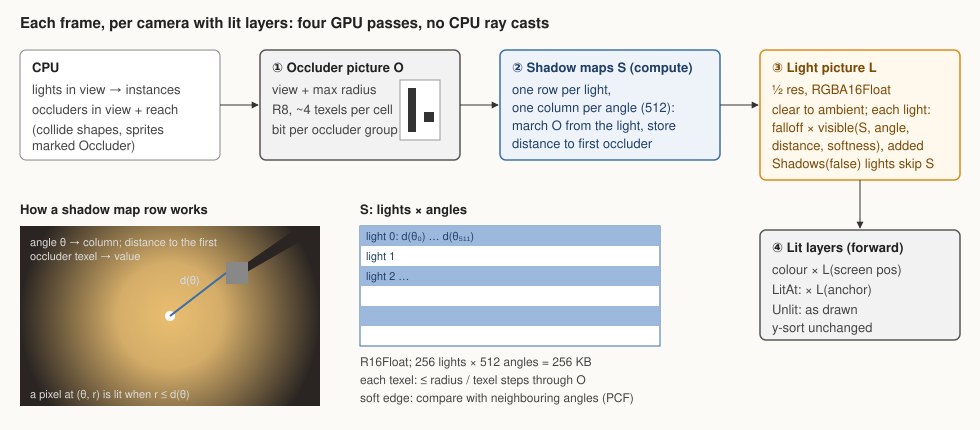
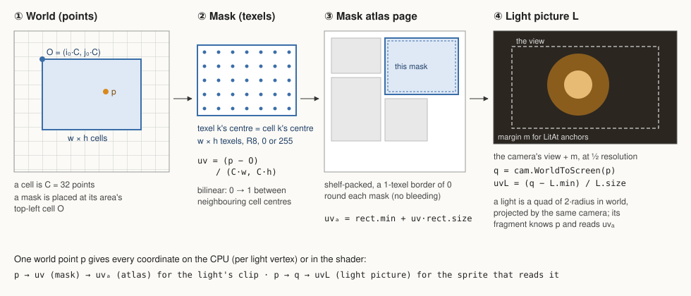
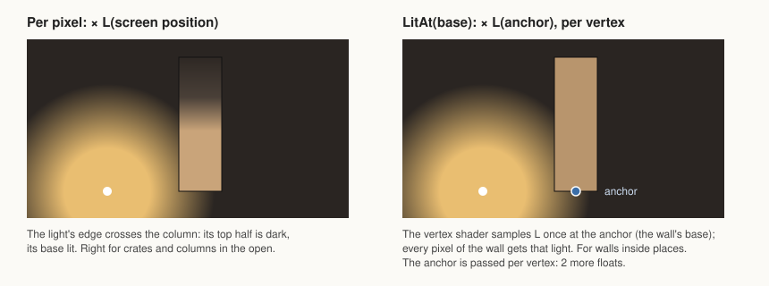
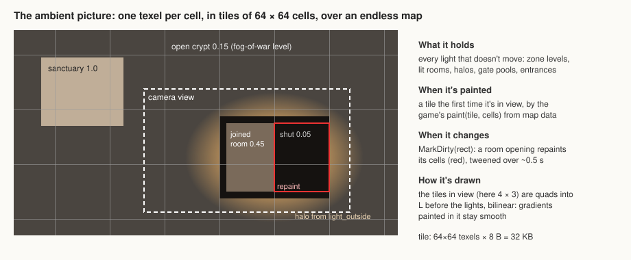

# 2D lights and shadows

Status: **built (2026-11-01): milestones 1–3 and the ambient map; Tier 1 of the roadmap (§8) being built.** It supersedes decision 0037 (no computed shadows) with decision 0042. The model is box2dlights' (libGDX): point, cone and directional lights, lights without shadows, soft shadows, filters. Its shadows are computed on the GPU instead of by CPU ray casts.

## 1. The frame



1. **Occluder picture O.** The CPU lists the occluders in view (plus the largest light radius) and draws them into O: one R8 texture at about 4 texels per cell, one bit per occluder group.
2. **Shadow maps S,** a compute pass. One row per light, one column per angle (512 by default). Each texel marches outward through O from the light and stores the distance to the first occluder in its group mask.
3. **Light picture L.** Half resolution, RGBA16Float, cleared to the ambient (a colour, or the ambient picture's tiles). Each light adds `colour × intensity × falloff(r) × visible(θ, r)`, where `visible` compares r with S's row, softened over neighbouring angles (PCF). Lights with `Shadows(false)` skip S.
4. **Lit layers,** forward. Each lit sprite multiplies its colour by L at its screen position. `LitAt(x, y)` samples L once at an anchor instead, and `Unlit()` skips L. Sorting is unchanged.

There are no CPU ray casts.

## 2. Coordinate spaces



**O and L** both cover the camera's view plus a margin, so their transforms come from the camera: `q = cam.WorldToScreen(p)`, then `uv = (q − min) / size`.

**S is polar per light:** `θ = atan2(p − centre)` gives the column, and `r = |p − centre|` is compared with the stored distance.

## 3. API (`ember/twod/light`)

```go
light.NewPoint(radius float32, c color.Color, opts...)           // a twod entity: child of what it follows
light.NewCone(radius float32, c color.Color, angle, spread float32, opts...)
light.NewDirectional(c color.Color, angle float32, opts...)      // sun or moon across the whole view
light.NewShape(shape, c color.Color, reach float32, opts...)     // full inside a rect, circle, capsule, line or polygon, fading over reach
light.Emissive(reach float32)                                    // sprite or tile option: its own silhouette glows and lights round it

// light options
light.Falloff(full)        // share of radius at full strength
light.Intensity(i)         // SetIntensity, SetColor, SetRadius, SetHidden at run time; flicker is game code
light.Shadows(on)          // casts shadows (default on, off for shape lights)
light.Size(points)         // the light's own size: the penumbra, sharp at the caster, 0 sharp
light.BlockedBy(groups)    // occluder groups that cast this light's shadows (default all)

// what blocks light
light.Occluder(groups)     // option on a sprite or tile map: its solid shape (collide shapes, else alpha) is drawn into O
light.OccludersFrom(space)     // every solid of a collide.Space occludes (tile maps, bodies)

// what is lit
light.Lit()                // layer option: its sprites read L
light.Unlit()              // sprite option: drawn as is (flames, eyes)
light.LitAt(x, y)          // sprite option: the whole picture takes L at one point (walls)
light.Ambient(c) / light.AmbientMap(picture) // camera options: the light every spot gets anyway

// rules: what the GPU drew, read back
probe := light.NewProbe()  // a 2D entity, child of what you ask about (an enemy)
probe.Light()              // the light there as drawn, 1–3 frames late; probe.Ready() once answered
```

**Directional lights** march O along one direction for the whole view (a second compute shader), with no row in S.

**Shape lights** fall off with the distance to their shape: exact distance functions in the shader for rectangles, circles, capsules, lines and polygons. For `Emissive`, the sprite's alpha is blurred once on the GPU into a glow texture. They cast no shadows by default. With shadows, N sample points along the outline (8 by default) each take a row in S, and their visibility is averaged: soft, area-like shadows. Emissive tiles are painted into the ambient picture, not drawn as one light each.

**As much as possible on the GPU** (user, 2026-11-01): shadows, shape distance, glow blurs and ambient tiles are all computed there. The CPU only lists what's in view and uploads what changed. Rules read the light through probes: each frame the GPU samples the light picture at every probe in view in one tiny pass, and the values come back asynchronously, 1–3 frames late, like the GPU timers. They include everything drawn (groups, softness, shapes, the sun, glows), so they can't disagree with the picture. A rule at a threshold adds hysteresis.

## 4. Lit sprites



The 2D vertex gains a light mode (0 unlit, 1 per pixel, 2 anchor) and an anchor coordinate (2 floats). L is one fixed texture binding per window, like the glyph atlas, so batching is unchanged.

## 5. Ambient over an endless map



A flat `Ambient(colour)`, or the tiled painted picture: one texel per cell, painted by the game as tiles come into view, repainted where something changes. It's drawn into L before the lights.

## 6. Costs and limits

| Item | Cost (estimates until measured) |
|---|---|
| O at view + reach | about 1–2 MB, one draw of the occluders in view |
| S | 256 lights × 512 angles × R16F = 256 KB; about 6.5 M texel reads for 200 lights of radius 250, about 1 ms or less |
| L | 1280 × 720 × 8 B = 7.4 MB at a 2560 × 1440 window |
| CPU | collect lights and occluders in view; nothing per ray |

**Limits:**
- shadows are as sharp as O's texels and S's angles; a very large light gets more angles (an option);
- at most 256 shadow-casting lights in view; lights with `Shadows(false)` don't count.

## 7. Built in milestones

1. **Point lights** (fcd30a8f, b0f277b3, done). Occluders from `collide` solids and `Occluder` sprites, S, L, `Lit`, `Unlit`, `LitAt`, ambient colour, `Shadows(false)`. A new guide page and example with GIFs: a torch walking between pillars.
2. **Cone, directional and shape lights** (4bfacf37, done; the ambient picture landed with the tiled picture, `light.AmbientMap`, 91f7a021), `Emissive`, `Softness`, `BlockedBy` groups, the ambient picture. Example GIFs: a flashlight, a day–night sun, a lava pool lighting the walls round it.
3. **Probes** (`light.NewProbe`, 2305472e, done) with a GPU-tagged agreement test, a lights golden, and performance numbers in performance.md (the probe pass against a CPU mirror, as the reason for the choice).

The demo doesn't move onto it until the user says so: they will try the examples and the API first (2026-11-01).

## 8. Roadmap (user, 2026-11-01)

The user approved Tier 1 for building: "go tier one, update doc, update editor". Tiers 2 and 3 are on record only.

**Tier 1, built (2026-11-02):**
1. **Debug views** (32766546, 1697de74): F3 toggles for the light picture, the occluder picture, the shadow maps, the light count and budget, and occluder outlines.
2. **Static lights baked on the GPU** (2c204f54): `light.Static()` lights are drawn once into tiles of the world, with their shadows, and redrawn only where nearby shapes change.
3. **Light budget and priority** (986ef3f7, decision 0047): `light.Priority(n)`, a per-camera `light.Budget(n)`, and `light.BudgetFade(seconds)` for lights dropped past it.
4. **Shadow colour and opacity per light** (322f18ef): `light.ShadowColor(c)`, `light.ShadowOpacity(f)`. Where a light's shadow falls, its light is let through times mix(1, colour, opacity): box, tile, silhouette and directional shadows, shaded pictures and static bakes alike.
5. **Height-based, softer shadows** (171ffb70, 7966810d):
   - a `height` on tiles and sprites, and `light.Elevation(h)` on lights;
   - a shadow ends at distance × height / (elevation − height);
   - `light.Size(points)` softens the edge with distance from the occluder (contact-hardening);
   - an optional `light.ShadowFade()`;
   - shadow maps keep up to two shadow intervals per angle.
6. **Which layers a light affects** (16eb28bb, decision 0048): `light.Affects(layers…)`, nested layers included; a picture per set of lights left out, 4 a window with ShadedBy's.
7. **Player brightness** (4d9fd59a): `light.Exposure(f)` on a camera, with `ExposureOf`/`SetExposure`; the light lit drawings read, scaled before its clamp, never what probes read.

**Built alongside Tier 1:** `light.ShadedBy(groups…)` (7b0093c4, 043b842f, decision 0045), `light.Silhouette(groups…)` (9f2971a7, 35a54b05, ac5b0132, decision 0046) with `draw.Light.Unblocked`, live setters through `world.Regroup` (dd0b4522).

**Alongside:** the standard tile properties ([Tiled tile properties](tiled-tile-properties.md), being written). One documented set of property names, types and defaults that the loader reads and checks, with a Tiled project file so Tiled shows them as typed fields. The tileset tool edits them from the same definition.

**Tier 2, when the art calls for it:**
- emissive maps;
- animated sprites casting from their silhouette;
- cone inner and outer angles, and custom falloff curves;
- light cookies;
- normal maps, with shininess and rim light;
- bloom;
- a flicker helper.

**Tier 3, later:**
- planar reflections;
- refraction and heat haze;
- coloured and translucent shadows;
- god rays;
- subtractive lights;
- 2D global illumination (radiance cascades).

**Known limit, later:** a tall tile takes its light 3 points past its sides, and the half-resolution light picture blurs shadow edges over 2 to 3 points, so a tile whose blocker's shadow edge runs that close to its side catches part of the light (a column at another's shadow edge draws 165 of 255). Finer light pictures near tall tiles would close it; the repro is `TestATallTileAtAnotherTallTilesShadowEdgeStaysDark` in gpu, skipped until then.
