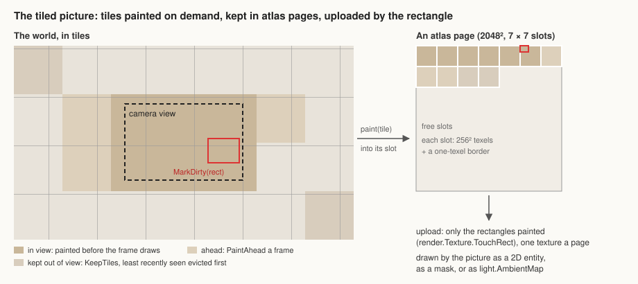

# The tiled picture

Status: **approved (2026-11-01); steps 1 and 2, the picture and `light.AmbientMap`, are built.**

A large picture, possibly endless, made of tiles the game paints on demand. It's the piece the ambient picture (`light.AmbientMap`, [2D lighting](2d-lighting.md) §5) and big maps both need. Today the demo builds one of its own for its big map (`demo/screens/bigtiles.go`); this note makes it an engine type.



## API (`ember/twod`)

```go
pic := twod.NewTiledPicture(paint,
	twod.TexelSize(32, 32), // world points a texel covers, 1×1 by default
	twod.TileTexels(256),   // a tile's side, in texels
	twod.KeepTiles(64),     // tiles kept painted out of view, least recently seen first to go
	twod.Pixelated(),       // nearest, sharp texels (maps of cells); bilinear by default (ambient light)
)

func paint(t twod.PictureTile) {                // the game's callback
	for y := t.Area.Min.Y; y < t.Area.Max.Y; y++ {  // only the texels to paint
		for x := t.Area.Min.X; x < t.Area.Max.X; x++ {
			t.Image.Set(x, y, colourOfCell(t.Cell(x, y)))
		}
	}
}

pic.MarkDirty(rect)  // world points: the texels under rect repaint, in the tiles that hold them
pic.Forget()         // every tile repaints when next seen
```

- **`PictureTile`** gives the callback:
  - **`Image`**: the tile's pixels, an `*image.RGBA` viewing its slot in an atlas page, written in place;
  - **`Area`**: the texels to (re)paint, in that image's coordinates;
  - **`Cell(x, y)`**: which world texel a pixel is, for looking up the game's data;
  - **`World`**: the world rectangle the tile covers.
- **A 2D entity:** a `*TiledPicture` is one, so it draws itself. In any layer it draws the tiles its camera shows, which makes it the source of a big map or a ground of decals. On an `AsMask` layer it masks, as any entity does there.
- **Light:** `light.AmbientMap(pic)`, a camera option beside `Ambient(c)`, makes the ambient light of each spot that spot's texel colour. Texels are stored in sRGB and read back linear, so dark levels keep their precision. A spot with no painted tile takes `Ambient(c)`.

## Data

- **Tiles:**
  - A map from tile index (x, y) to a tile: its atlas slot, the dirty texel rectangle not yet repainted, and the frame it was last seen.
  - A slot holds the tile's texels plus a one-texel border, painted from the neighbouring world texels, so smooth sampling never bleeds across slots.
- **Atlas pages:**
  - Each page is a `render.Texture` of 2048 × 2048, so 7 × 7 slots of 256 + 2 texels, and its `*image.RGBA`.
  - A slot's tile image is a sub-image of its page, so painting writes straight into what is uploaded.
  - Pages are only added: when the tiles in view need more slots than the pages hold, one more page comes. KeepTiles is the budget kept beyond what is in view.
  - So pages ≤ ceil((tiles in view + tiles painted ahead + KeepTiles) / 49). Each page past the first two is logged once, so a view that keeps growing shows.

## Painting

- **Tiles in view:** a tile the first time it's in view paints whole, before the frame draws, so a capture or a first frame is never half painted.
- **Neighbours:** a ring of tiles round the view is painted ahead, at most `PaintAhead` (4 by default) a frame, nearest first.
- **Dirty texels:** `MarkDirty` adds world texels to each tile's dirty rectangle. A tile in view repaints those texels before the frame draws; one out of view does it when next seen.
- **Thread:** painting runs on the World's goroutine, so the callback reads game data freely.

## Upload

- **Rectangles only:** a page uploads only the rectangles painted since its last upload, never the whole page.
- **`render.Texture` gains `TouchRect(r)`:** it records a changed rectangle as well as bumping the version, as `Touch` does. gpu writes each rectangle with `WriteTexture` at its origin, through a new binding call. A version change without rectangles re-uploads the whole texture, as today.
- **Draws:** each page is one texture, so a view's tiles draw as one batch of quads (a few pages at most).

## Eviction

- Tiles in view are never evicted.
- Out of view, a tile keeps its slot until a new tile needs one and none is free. Then the tile seen longest ago, past the newest KeepTiles, gives its slot up, and its texels are painted again if it comes back.
- Edits made with MarkDirty while a tile is evicted cost nothing: it repaints whole when it returns.

## Costs

| Item | Cost |
|---|---|
| A page | 2048² × 4 B = 16 MB, on the CPU and the GPU, for 49 tiles of 256² |
| Ambient at a texel a 32-point cell | a 256 tile covers 8,192 points: a window's view needs 1–4 tiles |
| Big map at a texel a cell | the same tiles, zoomed: the view's 4–12 tiles |
| Upload | only what is painted: a room opening is a few hundred texels |

## Alternatives

- **One texture per tile:** simpler, but every tile is its own binding, breaking batches, and gpu's texture cache would need to forget evicted ones.
- **Painting on the GPU, with a shader per picture:** that means game rules in WGSL. Painting is the game's own data (explored cells, room states), read on the CPU, and the GPU already does the drawing and the light.
- **Growing one big texture:** endless worlds don't fit it.

## Built in steps

1. `TiledPicture`, drawing, painting, eviction and partial uploads, with GPU-free tests (painted areas, dirty rectangles, slot reuse, the border) and a GPU-tagged one (a dirty rectangle uploads only itself).
2. `light.AmbientMap`, with a GPU test (spots take their texel's light, and smoothly between texels with `Smooth`).
3. A guide page with an example: a fog-of-war map repainted as the hero walks.
