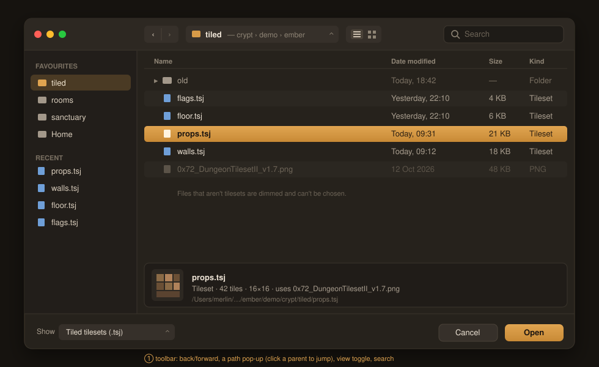
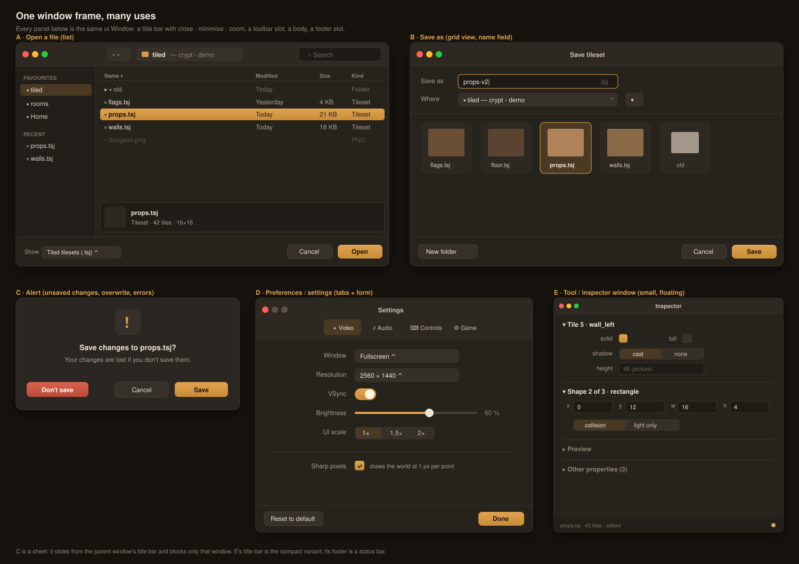

# Windows, dialogs and their components

Status: **mockups approved by the user (2026-11-02); built in ui/kit (M3) and the tileset tool (M4).**

The user asked for the file dialog to be split into reusable parts ("it is a basic window ui with open/reduce/close"), shown in several uses. Both mockups were approved.

## Components

| Component | New or existing | Used by |
|---|---|---|
| `ui.Window`: title bar (close, minimise, zoom; compact variant), toolbar and footer slots, drag, resize, stacking, modal | new | all |
| `ui.Alert`: icon, title, message, buttons; sheet mode on a parent window | new | alert |
| Button styles: primary (default, Enter), secondary, destructive (theme classes) | new style | all |
| Toolbar | new | open, save |
| Sidebar list: section titles, icon rows, selection | new | open |
| Table: columns, header sort, row selection, expandable rows, long lists | new | open |
| Thumbnail grid | new | save |
| Path pop-up | new | open, save |
| Pop-up button (drop-down) | new | open, save, settings |
| Search field | new | open |
| Tab bar (icon tabs) | new | settings |
| Toggle switch | new | settings |
| Form layout: aligned label and field columns, separators | new | settings, inspector |
| Number field | new | inspector |
| Status bar | new | inspector |
| Text truncation with "…" (`ui.Truncate`) | landing | open, save, inspector |
| Foldable titled sections, segmented choice, slider, check, text input, menu bar, tooltip, scroll, icons | existing | all |

## Title bars

Inside a game window, a `ui.Window` draws its own title bar. A dialog in its own OS window uses the system's native title bar and draws none.

## Order

1. `ui.Window`, button styles, `ui.Alert` and the form layout, which give the tileset tool its inspector and its prompts.
2. Table, sidebar list, path pop-up, pop-up button and search field, for the new FileDialog.
3. Thumbnail grid, tab bar, toggle switch, number field and status bar.

Every component is themed (spacing and colours from the theme), has keyboard and pad navigation and automation IDs, tests that need no GPU, and its own page in the UI components reference.
